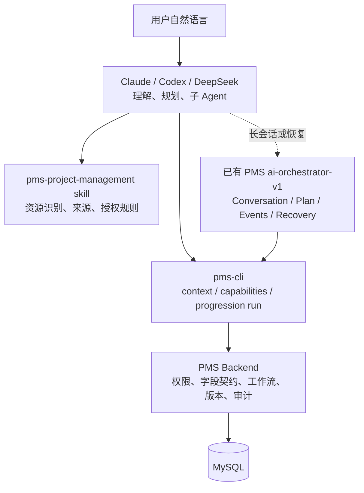

# 四类资源统一 Agent 推进协议与现有 Orchestrator 扩展设计

日期：2026-10-19

## 目标

让 Claude、Codex、DeepSeek 等外部 Agent 能通过同一套 PMS 协议推进项目、需求、专题、故事，并把已有的 `ai-orchestrator-v1` 扩展到四类资源，而不是另建一套会话系统。

目标体验是：

```text
用户自然语言
  → Claude / Codex / DeepSeek 理解意图、调用子 Agent
  → pms-cli 读取 PMS focused context 和能力契约
  → Agent 生成带来源的 Agent Draft
  → progression run 生成计划和 preview
  → 按风险策略执行
  → focused readback 验证实际字段
  → Agent 用名称和业务语言汇报
```

模型、自然语言理解、子 Agent 调度属于外部 Agent 或已有 Orchestrator；`pms-cli` 是无状态 PMS 协议客户端和执行边界。

## 当前基线

### 已存在并应复用的能力

- `pms-cli` 已有 `context / capabilities / plan / preview / execute / progression run`；
- requirement、topic、story 已有 resource-scenario 和 story workbench 路径；
- project 已有 adapter、`saveContract`、项目级命令和节点命令；
- PMS 已有 `ai-orchestrator-v1`、Conversation、Plan、OperationEvent、Verification、持久化表和接口；
- connector 已有 `PmsClient` 的 orchestrator 会话方法；
- 已有 `resource-scenario-real-pms.e2e`、story acceptance 和 orchestrator E2E，第一阶段应扩展这些测试。

### 需要修正或补齐的事实

1. project 的 resource projection 本身较完整，topic/story 的 resource projection 才需要重点和 focused context 合并；
2. `contextVersion` 是会话/审计关联信息，不是后端真正的并发写入锁；真正的保护来自 preview 捕获的节点、字段和工作流版本；
3. `auditId` 当前等于 `operationId`（`AiOperationResultDTO.from` 将两者设为同一值），应作为 opaque 审计关联标识；不能在产品语义上假设存在独立审计实体。unknown write 第一阶段只能使用同幂等键重放，当前没有 `GET /operations/{id}`；
4. 当前 `run` CLI 默认值是 `auto`，必须改为 `plan`；
5. 当前 executor 回读使用非 focused context，并且没有把本次写入参数传给 verifier；
6. 外部 Agent 的 draft 来源目前只在 CLI 本地校验，没有进入 PMS operation/audit。

## 架构边界



### 边界原则

- `pms-cli` 不保存模型 URL、API Key、模型名，也不调用模型 API。
- 外部 Agent 负责识别资源、节点、意图、字段来源、子 Agent 结果和用户授权。
- 现有 Orchestrator 负责会话持久化、计划恢复、事件和跨轮次状态；不复制 CLI adapter。
- PMS 后端是权限、工作流、字段契约、版本、事务、幂等和审计的最终权威。
- Agent 节点写入的标准入口是 `scenario progression run`；旧入口保留兼容，但不再由 skill 推荐。
- CLI 不猜测节点、字段、负责人、日期或模板；无法确认的信息返回 `NEEDS_INPUT`。
- 第一阶段只覆盖本地 CLI/外部 Agent；远程委派 token 的 preview、orchestrator 路由和最小 scope 另列跨仓库任务，不假设当前 allow-list 已支持。

## 统一 Agent 协议

### 资源与意图

四类资源共享：

```text
READ_CONTEXT
UPDATE_NODE_FIELDS
COMPLETE_NODE
```

`project.create`、`project.update` 是项目级扩展操作，继续使用 resource-scenario，不强行塞入节点 progression schema。

### Component / Workbench 选择

节点可能包含多个可写组件，Agent 必须明确写入哪个组件：

- 协议使用统一的可选 `componentKey`；项目的 `workbench` 作为兼容输入，进入 CLI 后立即归一化为 `componentKey`；
- 判定单位是“可写 saveContract”，不是 component 数量：恰好一个可写 saveContract 时可以省略 `componentKey`；多个可写 saveContract 且未指定 `componentKey` 时返回 `CAPABILITY_UNAVAILABLE`；指定的 component 没有可写 saveContract 时，写入意图返回 `CAPABILITY_UNAVAILABLE`，但只读 context 仍可返回该 component 的内容并标注 `writeCapable=false`；
- 0 个可写 saveContract 只在 `UPDATE_NODE_FIELDS`/`COMPLETE_NODE` 下返回 `CAPABILITY_UNAVAILABLE`；`READ_CONTEXT` 必须继续可读，并明确标注不可写；
- 共享 resolver 放在 `apps/pms-cli/src/commands/core/componentResolver.ts`，由 `agentContext.ts`、Agent Draft validator 和四类 adapter 共同引用；不允许各处自行选择“第一个 component”；
- story 的 `story-node-workbench` 是后端固定业务组件。resolver 必须通过统一入口解析，但候选集合只能来自后端 context 中声明的合法组件，不能让外部传入的任意 `componentKey` 绕过 story policy；story adapter 不得自行接受未声明的组件 key。
- `pms context --format agent --view focused` 在多组件节点上必须通过 `--component <componentKey>` 读取具体 nodeContract；当前 CLI 规定 `--component` 只能与 `--view focused` 同时使用；
- context reader、Agent Draft validator、project/requirement/topic/story adapter 共用同一个 component resolver，确保看到和写入的是同一份 saveContract；
- readback 使用该 component 的 content/fieldValues 和 `saveContract.fieldContracts` 提取实际字段。

### 版本语义

不同资源的节点版本来源不同，不能用一个 `context.version` 解释全部资源：

| 资源 | nodeVersion 来源 | entityVersion | preview 实际守卫 |
| --- | --- | --- | --- |
| project | `workflow.nodes[].version` / `saveContract.nodeVersion` | project entity version | project/workbench/field versions；完成时额外校验 nodeVersion |
| requirement | `context.version` / selected node.version | requirement entity version | node version |
| topic | `context.version` / selected node.version | 当前可能为空 | node version |
| story | `context.version` / selected node.version | 当前可能为空 | node version + component versions |

`agent-progression/v2` 与 `agent-progression-run/v2` 是本阶段的破坏性协议升级，不再兼容旧的 `agent-progression/v1`、`agent-progression-run/v1` 或 progression 命令的旧 `--version` 参数语义。CLI 的 progression 命令使用显式的 `--node-version` 传递节点版本，使用独立的 `--context-version` 传递 opaque 的会话/审计关联信息；其他 CLI 命令已有的 `--version` 参数不在本次删除范围内。结构化请求使用同名的 `nodeVersion`/`contextVersion` 字段。旧协议和旧参数必须返回明确的迁移错误，不能静默解释为新字段。节点版本优先使用 `nodeContract.version`，真正的并发保护由 PMS preview 捕获的 project、node、workbench、field 版本和 execute guard 完成。connector、PMS backend、skill、fixture 和外部调用示例必须在同一发布批次升级到 v2。

### Draft 与来源

Agent Draft 至少包含：

```json
{
  "facts": [{"text": "测试结果为通过", "sourceRefs": ["requirement-node:12"], "confidence": "high"}],
  "inferences": [],
  "assumptions": [],
  "unresolvedDecisions": [],
  "fieldSources": {
    "testResult": {"sourceType": "pms_context", "sourceRefs": ["requirement-node:12"], "confidence": "high"}
  },
  "patch": {"testResult": "PASS"},
  "requestedCompletion": true
}
```

本阶段采用后端 provenance 方案：preview 请求携带规范化后的字段级 `fieldSources`、`draftDigest` 和来源类型，PMS 将其持久化到 operation/plan/audit，并在 preview 结果回显 provenanceRef。CLI 仍不保存完整对话，只传递可追踪引用。

事实、推断和假设都必须有来源；`sourceRefs` 为空时不能进入 patch。来源引用必须是当前权限可读取的 PMS context sourceRef；Orchestrator 对话必须先建立对应会话引用并投影为可读 sourceRef。外部 Claude/Codex 本地聊天记录不能直接充当 PMS 可验证来源。假设只能用于解释或生成补问，不能直接写入 PMS。未决决策和低置信高风险推断返回 `NEEDS_INPUT`。

### 来源持久化契约（Milestone 3 前冻结）

- preview 请求增加可选的 `provenance` 对象，形状固定为：

```json
{
  "contractVersion": "draft-provenance/v1",
  "draftDigest": "sha256:<hex>",
  "fieldSources": {
    "testResult": {
      "sourceType": "pms_context",
      "sourceRefs": ["requirement-node:12"],
      "confidence": "high"
    }
  }
}
```

- `draftDigest` 的规范化输入固定为 `{contractVersion, resourceType, resourceId, nodeId, componentKey, intent, requestedCompletion, versionSnapshot, facts, inferences, assumptions, unresolvedDecisions, patch, fieldSources}`，其中 `versionSnapshot` 固定包含 `{nodeVersion, entityVersion, workflowInstanceVersion, componentVersion, contextVersion}`；未知值用 `null`，不得省略。递归按 key 排序，`sourceRefs` 按字典序排序，其余数组保持声明顺序；不含空白，UTF-8，SHA-256，前缀 `sha256:`。排除 requestId、operationId、时间戳、凭据和完整对话。preview 必须返回 PMS 实际校验后的 `expectedVersions`，digest 必须绑定该版本快照；execute 只能引用原 preview 的 digest 和版本快照。
- 存储：`pms_ai_operation` 增加可空 `provenance_json LONGTEXT` 列（现有表没有通用 metadata 列）；Orchestrator 的 `pms_ai_plan` 复用 `draft_json`，不新增列；`pms_ai_operation_event.detail_json` 只记录 `provenanceRef` 和 digest，不复制完整来源。
- `provenanceRef` 固定为 `operation:<previewOperationId>`；preview 响应回显该引用和 digest，execute 只引用已 preview 的 provenance，不接受新的 provenance。
- 限制：`fieldSources` 最多 200 个字段，每个字段最多 20 个 `sourceRefs`，序列化后不超过 64 KiB；超限返回 `PROVENANCE_TOO_LARGE`，非法 `sourceRefs` 返回 `PROVENANCE_INVALID`，两者在 run 边界映射为 `REJECTED`，并分别返回对应的 `rejectionReason`，不能伪装成缺少业务字段。
- `sourceRefs` 沿用现有 CLI/后端可验证格式，不新增 `pms:` 或 `conversation:` 命名空间：
  - 资源：`<resourceType>:<resourceId>`（如 `project:42`、`requirement:33`）；
  - 节点：`<resourceType>-node:<nodeId>`（如 `project-node:3`）；
  - 组件：`<resourceType>-node:<nodeId>#component:<componentKey>`（如 `project-node:3#component:project-basic-info`）；
  - story workbench 额外允许后端声明的 `story-node:<nodeId>` 与 `story-node:<nodeId>#component:story-node-workbench`。
- 本阶段不支持 `conversation:<id>:turn:<n>`。外部 Agent 的对话引用必须先由 Orchestrator 建立并投影为可读 context/sourceRef，否则只能作为 `NEEDS_INPUT` 的待补充信息。
- 上述格式由 `agentContext.ts`、`AgentDraftContract.ts` 和 `AiAgentDraftValidator.java` 共同校验；generic `validate()` 的 `readableReferences` 必须同时接受资源、节点和组件 ref，不能只接受 resource/relation。若未来迁移格式，必须作为独立契约任务同时修改 CLI、后端验证器和全部测试，不能只改文档。
- 不得写入完整消息正文、Token、密码或自由文本。
- 发布顺序：后端先上线（接收可选 provenance，旧客户端不带 provenance 时保持兼容）；connector 随后。CLI 在写入前检查 capabilities 的 `provenanceVersions` 是否包含 `draft-provenance/v1`。
- 失败策略：`progression run` 的 `UPDATE_NODE_FIELDS`/`COMPLETE_NODE` 在后端不支持 provenance 时必须阻止写入，返回 `CAPABILITY_UNAVAILABLE`，`warnings` 固定包含 `PROVENANCE_NOT_SUPPORTED`，不生成 preview、不写入；不得降级为警告后继续写。
- 兼容策略：旧 `resource-write`/`operation auto` 入口可以继续执行，但结果 `warnings` 固定包含 `PROVENANCE_NOT_AUDITED`，文档和 skill 标记为 legacy，且不得宣称完成了来源审计。

### 授权与状态

- `READ_CONTEXT` 和 `plan` 永远不写入；
- `run` 默认 `execute-mode=plan`，`auto` 必须显式指定并提供幂等键；
- `auto` 只能执行 low/medium 风险；high-risk 必须 `confirm`；
- 未决决策、低置信度高风险推断、缺少字段来源统一返回 `NEEDS_INPUT`，不因 confirm 自动放行；
- `COMPLETE_NODE` 必须显式提供 `requestedCompletion=true`；缺失或为 false 时不得生成完成预览。固定映射为：`run.status=REJECTED`、`run.writeDecision=NEEDS_INPUT`、`plan.preview=null`、`rejectionReason=COMPLETION_NOT_REQUESTED`，并要求调用方改用 `UPDATE_NODE_FIELDS`；
- 当前节点不一致固定返回 in-band `CONFLICT`；缺少业务字段或尚未建立可读会话来源返回 `NEEDS_INPUT`；非法或超限 provenance 返回 `REJECTED`；
- 预期业务状态使用 in-band `agent-progression-run/v2`；认证、网络、协议解析等系统错误才使用 `ok:false` 错误信封；旧 `agent-progression-run/v1` 必须返回迁移错误；该收敛在 Milestone 0/1 完成，不延后到文档阶段；
- 所有 progression 写入必须校验 `nodeId === currentNode.id`，历史节点补录另建独立意图；
- CLI 不自动重试未知写入，第一阶段只允许使用同一 conversation、同一 preview、同一 draftDigest 下的幂等键重放；不同 preview 或不同 digest 不得复用幂等键。

### 结果

结果统一包含：

- `status`：`CONTEXT_READY`、`PLAN_READY`、`NEEDS_INPUT`、`WAITING_CONFIRMATION`、`CAPABILITY_UNAVAILABLE`、`SUCCEEDED`、`REJECTED`、`CONFLICT`、`WRITE_RESULT_UNKNOWN`；
- `writeDecision`、`missingFields`、`warnings`；
- `plan.context`、`plan.preview`、`plan.missingFields`，以及 `result.operation`、`readback`、`verification`；
- `previewOperationId`、`operationId`、`auditId`；`auditId` 当前等于 `operationId`，按 opaque 审计关联标识处理，不假设独立审计实体；
- 可选 `rejectionReason`：仅在 `status=REJECTED` 时出现，固定枚举至少包含 `COMPLETION_NOT_REQUESTED`、`PROVENANCE_INVALID`、`PROVENANCE_TOO_LARGE`；
- `userFacing`：资源名称、资源状态、当前节点、目标节点、字段变更、阻塞；这些字段在契约中明确存在，不再保留“是否增加”的未决设计；
- 内部 ID、版本和 requestId 仅保留在机器可读字段。

## 四类资源行为

| 资源 | 读取 | 节点写入 | 特殊规则 |
| --- | --- | --- | --- |
| 项目 | project 详情 + focused context | `node.field.update` / `node.complete-with-data` | 节点写入先做 focused preflight；`project-basic-info` 走 `project.update` |
| 需求 | resource + focused context | `development-item.node.*` | 无 saveContract 只读并返回能力不可用 |
| 专题 | resource + focused context | `development-item.node.*` | topic projection 与 focused context 合并；UNSUPPORTED 不能猜字段 |
| 故事 | resource + story workbench focused context | story workbench / development item 命令 | 保留独立 adapter，但统一结果、错误和 readback |

当前节点校验只适用于真正的节点写入。`project.create`、`project.update`（包括 `project-basic-info`）属于资源级操作，不要求 `nodeId === currentNode.id`；只有 `node.field.update` / `node.complete-with-data` 等节点命令才执行当前节点校验。

项目 `solution-decision`、`custom-fields` 当前如果没有 context saveContract，明确返回 `CAPABILITY_UNAVAILABLE`；不在 CLI 中猜测字段。项目节点 capability 的 `project_node` 分组在矩阵中显式映射，不假设它一定位于 `project` 分组。

项目的 `fieldContracts/requiredFields` 如果后端尚未提供，第一阶段只承诺由 preview preconditions 返回缺失信息；只有后端补齐契约后，才承诺与 development item 完全一致的 `missingFields`。

context 中的 `saveContract` 是运行时字段能力契约，和后端 YAML agent contract 的 `contractId/contractVersion` 不是同一个概念。节点命令不因为存在 saveContract 就自动附加 YAML contract 绑定，避免触发不兼容的 409。

## 阶段划分

### 第一阶段：事实与安全语义冻结

- 盘点现有 Orchestrator、progression、旧写入口、capability、版本轴和 E2E；
- 修正默认 `plan`、业务状态收敛、当前节点校验和 `requestedCompletion`；
- 明确 draft provenance、旧入口边界和版本字段；
- 不开始共享 verifier 重构，避免在语义未冻结前返工。

### 第二阶段：project/story preflight 与 readback

- project 节点统一 focused preflight；
- executor 使用 focused context 并传递 `nodeId`、normalizedArguments、saveContract；
- 四类资源真正比较写入字段；
- 统一保护字段和本次合法变更字段；
- topic/story 资源投影与 focused context 合并。

### 第三阶段：provenance、结果和 Agent 交接

- 跨后端和 connector 持久化 draftDigest/sourceRefs；
- 完善 `userFacing` 的目标节点和字段名称；
- skill 明确主 Agent、子 Agent、来源、补问和授权边界；
- 旧写入口标记 legacy，不作为标准 Agent 节点写入路径。

### 第四阶段：真实 E2E 与发布门禁

- 先扩展已有 resource-scenario、story acceptance 和无状态 progression E2E；Orchestrator E2E 等待第五阶段的 project/topic 会话映射完成后再扩展；
- project/topic 的节点写入 E2E 必须使用新增 fixture creator 在隔离库创建资源并推进到目标可写节点；`PMS_E2E_PROJECT_ID`/`PMS_E2E_TOPIC_ID` 仅保留给只读或兼容基线，不能作为节点写入成功路径的唯一数据来源；
- 覆盖四类资源的成功、NEEDS_INPUT、WAITING_CONFIRMATION、幂等、冲突、unknown 和 capability unavailable；
- 沿用现有 `PMS_E2E_RESOURCE_SCENARIO`、`PMS_E2E_STORY_ACCEPTANCE`、`PMS_E2E_WRITE`、`PMS_E2E_ISOLATED` 等安全门禁。

### 第五阶段：扩展已有 Orchestrator

- 复用 `ai-orchestrator-v1` 的 Conversation、Plan、OperationEvent、PlanView 和 Verification；
- 将 requirement analysis/story node 的既有路径抽象到四类资源；
- 让 `agent-progression-run/v2` 成为 Orchestrator 和外部 Agent 共用的无状态执行边界；旧 `agent-progression-run/v1` 不再作为执行入口；
- 实现前先产出 resource × intent 到现有 PlanView 的 adapter mapping 表；M5.2 恢复闭环必须先列出 Files/Interfaces/Tests 才能开工；
- 先完成一个资源、一个会话、一个待确认节点的恢复闭环，再扩展多资源依赖。

## 完成定义

1. 四类资源均可通过统一 progression run 读取、计划、预览、可控执行和 focused readback；
2. `run` 默认 plan，未决决策和低置信高风险推断不会因 confirm 被写入；
3. 所有节点写入都校验当前节点、能力契约、preview 版本、幂等键和实际字段回读；
4. provenance、operation、readback 和状态可追踪；`draftDigest` 绑定 `versionSnapshot`，sourceRef 格式与 CLI/后端 validator 一致；
5. 默认展示名称和业务术语，机器字段保留内部 ID；
6. 现有 Orchestrator 复用而不是复制；
7. 每个任务都经过聚焦测试、代码 review、回归测试后才进入下一任务。
