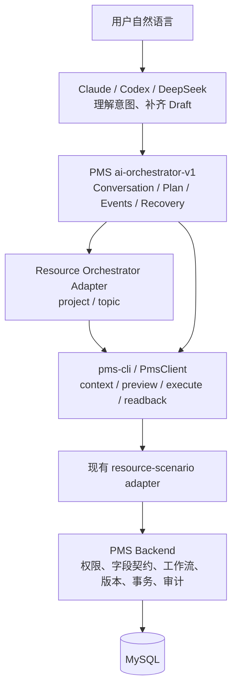

# 项目与专题 Orchestrator 映射设计

日期：2026-10-20

## 目标

在不新建会话模型、不复制 PMS 业务规则的前提下，将项目和专题接入现有 `ai-orchestrator-v1`。外部 Claude、Codex、DeepSeek 等 Agent 可以通过同一组 Conversation / Plan / Event / Recovery 接口，多轮补齐项目或专题当前节点信息，再由现有 `resource-scenario` 和 PMS operation 边界完成安全写入。

目标体验：

```text
用户自然语言
  → 外部 Agent 识别项目/专题、当前节点和意图
  → Orchestrator 创建会话并读取 focused context
  → Agent Draft 校验，缺字段时返回 NEEDS_INPUT
  → 生成 PLAN_READY
  → PMS preview
  → confirm / execute
  → focused readback + verification
  → 会话事件和计划可恢复
```

## 当前基线

系统已经具备：

- PMS 后端 `ai-orchestrator-v1` 的 Conversation、Plan、OperationEvent、Verification 和恢复状态机；
- requirement 与 story 的 Orchestrator 会话实现；
- Connector 的 `PmsClient` 会话方法和 `orchestratorPlanSchema`；
- project/topic 的 `resource-scenario`、focused context、saveContract、preview、execute、readback 和真实隔离 E2E；
- PMS operation 的权限、版本、幂等、审计和回读能力。

当前限制是后端创建会话只允许 `requirement` 或 `story`，Connector 计划契约也只接受这两类资源。项目、专题虽然可以通过无状态 `resource-scenario` 执行，但不能进入持久化 Orchestrator 会话。

## 范围

本阶段包含：

1. Conversation 支持 `project`、`topic`；
2. 项目和专题当前节点的字段更新会话；
3. 项目和专题当前节点的完成会话；
4. 多轮 `NEEDS_INPUT`、Plan、preview、confirm、execute、readback、幂等重放、版本冲突和跨进程恢复；
5. Connector 契约、后端适配器、契约测试和真实隔离 E2E；
6. 保持现有 requirement/story Orchestrator 和无状态 resource-scenario 的兼容性。

## 非目标

- 不新增 Conversation、Plan 或 Event 数据表；
- 不让 Orchestrator 直接访问数据库或复制 PMS 字段校验；
- 不重写 `resource-scenario`；
- 不把项目 `project-basic-info` 资源级更新伪装成节点会话；
- 不在本阶段实现多资源事务、自动审批、远程委派 token 或聊天 UI；
- 不改变现有 requirement/story 的意图和契约版本。

## 架构边界



职责固定为：

- 外部 Agent：自然语言理解、资源识别、Draft 生成、来源补齐和子 Agent 调度；
- Orchestrator：持久化会话、轮次、计划、事件、状态转换和恢复；
- Resource Adapter：把 `project/topic + intent` 映射成既有 context、saveContract 和 operation；
- Connector：无状态调用 PMS 的 context、capabilities、preview、execute 和 readback；
- PMS：权限、字段白名单、工作流、版本、事务、幂等和审计的最终权威。

## 统一资源映射

现有 requirement/story 继续使用原有意图；project/topic 使用新增的通用资源节点意图，由 `resourceType` 区分具体资源。

| resourceType | intent | focused context | preview command | execute command | 回读 |
| --- | --- | --- | --- | --- | --- |
| requirement | `REQUIREMENT_ANALYSIS_SAVE` | requirement focused/analysis | `requirement.analysis.save` | 同 preview operation | requirement detail + context |
| story | `STORY_NODE_FIELD_UPDATE` | story focused/workbench | `development-item.node.field.update` | 同 preview operation | story detail + selected component + context |
| project | `RESOURCE_NODE_FIELD_UPDATE` | project focused + selected component | `node.field.update` | 同 preview operation | project detail + focused component + context |
| project | `RESOURCE_NODE_COMPLETE` | project focused + selected component | `node.complete-with-data` | 同 preview operation | project detail + workflow/context |
| topic | `RESOURCE_NODE_FIELD_UPDATE` | topic focused + selected component | `development-item.node.field.update` | 同 preview operation | topic detail + focused component + context |
| topic | `RESOURCE_NODE_COMPLETE` | topic focused + selected component | `development-item.node.complete-with-data` | 同 preview operation | topic detail + workflow/context |

项目的 `project-basic-info` 仍然使用 `project.update` 资源级路径；如果当前节点没有可写 saveContract，只允许读取并返回 `writeCapable=false`，不能生成节点写入计划。

## 契约设计

### Conversation

现有接口保持不变：

```text
POST /integration/ai/v1/orchestrator/conversations
GET  /integration/ai/v1/orchestrator/conversations/{conversationId}
```

`resourceType` 扩展为：

```text
requirement | story | project | topic
```

创建会话时必须验证资源存在、当前用户可读，并把资源类型和资源 ID 持久化到已有 Conversation 表。

### Draft

项目/专题使用新的 `resource-node/v1` Draft 包装，不复用 requirement 或 story 的专用版本：

```json
{
  "contractVersion": "resource-node/v1",
  "draft": {
    "facts": [],
    "inferences": [],
    "assumptions": [],
    "unresolvedDecisions": [],
    "patch": {
      "fieldKey": "fieldValue"
    },
    "requestedCompletion": false,
    "fieldSources": {}
  }
}
```

`nodeId`、`componentKey`、`contextVersion` 由 turn 请求传递；真正的可写字段、必填字段、保护字段和版本以 PMS focused context 的 saveContract 为准。Draft 中的 `patch` 不得携带 `ownerId`、状态、资源 ID、节点 ID 或其他保护字段。

### PlanView

继续复用现有 PlanView，不新建 `ProjectPlanView` 或 `TopicPlanView`。新增字段只限于现有 story 已有的通用节点信息：

- `intent`：`RESOURCE_NODE_FIELD_UPDATE` 或 `RESOURCE_NODE_COMPLETE`；
- `resourceType`：`project` 或 `topic`；
- `nodeContract`：当前 saveContract 投影；
- `missingFields`、`questions`：由后端声明的必填字段生成；
- `preview`、`operation`、`verification`：沿用现有格式。

其中 `preview` 必须保留 PMS 返回的 `expectedVersions`、`provenanceRef`、`draftDigest` 和 `warnings`，execute 只能引用原 preview。

`nodeContract` 必须抽象成资源无关的节点契约投影，不能把现有 story 专属 `StoryNodeContract` 原样当成 project/topic 契约。公共部分包括 `nodeId`、`key`、`label`、`version`、`writableFields`、`protectedFields`、`allowedActions`、`allowedTransitions`、`missingInputRules` 和 `writeCapable`；组件级契约可携带 `componentKey`、`variant`、`requiredFields` 与 PMS `fieldContracts`。已有 story 响应字段保持兼容，project/topic 只使用后端实际声明的字段，不补造默认值。

### API

以下路由不增加新路径，仅扩展资源和契约校验：

```text
POST /integration/ai/v1/orchestrator/conversations
POST /integration/ai/v1/orchestrator/conversations/{id}/turns
POST /integration/ai/v1/orchestrator/plans/{id}/preview
POST /integration/ai/v1/orchestrator/plans/{id}/confirm
GET  /integration/ai/v1/orchestrator/conversations/{id}/events
GET  /integration/ai/v1/orchestrator/conversations/{id}/session
```

## 会话流程与状态

项目和专题遵循与故事相同的状态机：

```text
ACTIVE
  → CONTEXT_READ
  → DRAFT_VALIDATED
  → NEEDS_INPUT 或 PLAN_READY
  → PREVIEW_CREATED
  → WAITING_CONFIRMATION
  → EXECUTION_STARTED
  → EXECUTION_FINISHED
  → VERIFICATION_FINISHED
```

异常状态保持现有语义：

- 当前节点、contextVersion、expectedVersions 不一致：`CONFLICT`；
- 缺少必填字段、来源或可写组件：`NEEDS_INPUT` / `CAPABILITY_UNAVAILABLE`；
- `RESOURCE_NODE_COMPLETE` 必须显式提供 `requestedCompletion=true`，否则返回 `NEEDS_INPUT`，不生成 preview；
- PMS preview/execute 返回失败：保留 PMS operation 状态和错误码；
- 执行结果未知：进入 `WRITE_RESULT_UNKNOWN`，只允许使用原会话、原 preview 和原幂等键恢复；
- 重复 confirm 使用同一幂等键返回同一 operation/result，不重复写入。

## Adapter 设计

新增后端 `ResourceOrchestratorAdapter`（或等价的资源适配器注册表），只负责：

1. 根据 `resourceType` 读取 focused context；
2. 通过后端声明的 component/saveContract 解析节点能力；
3. 检查当前节点、组件、版本和 Draft patch；
4. 生成既有 `CommandPreviewRequest`；
5. 选择资源 detail/context 的回读方式；
6. 投影通用 `PlanView`、`VerificationView` 和问题列表。

它不实现项目或专题的字段业务规则。字段校验、权限、版本和最终写入继续由 PMS connector/operation 命令负责。

Connector 侧新增资源类型和 `resource-node/v1` schema，并让现有 `PmsClient` 的 conversation/turn/preview/confirm/session 方法直接复用；不新增另一套 HTTP 客户端。

## 安全与兼容

- 创建和读取会话必须按当前用户权限校验资源；不能通过会话绕过 resource-scenario 权限；
- 所有写入仍然必须经过 PMS preview/execute、版本守卫、幂等和审计；
- 只读 context 和 plan 不产生业务写入；
- 旧 requirement/story Orchestrator 响应保持兼容；
- 旧 resource-scenario 入口继续可用；
- `resource-node/v1` 与 `requirement-analysis/v1`、`story-workbench/v1` 分开演进；
- 不在 Orchestrator 保存完整聊天正文、Token、密码或模型凭据。

## 验收矩阵

### Connector 契约测试

- Conversation resourceType 接受 project/topic；
- project/topic Draft、PlanView、Preview、Operation 和 Session schema；
- `NEEDS_INPUT`、`CAPABILITY_UNAVAILABLE`、`CONFLICT`、幂等重放的响应解析；
- preview metadata 和 operation warnings 不被严格 schema 拒绝；
- 旧 requirement/story schema 回归通过。

### 后端测试

- 创建 project/topic 会话的权限和资源存在校验；
- focused context 的 currentNode、component、saveContract 和版本校验；
- project/topic 字段更新和节点完成的 command mapping；
- 缺字段、错误节点、并发版本冲突、非法字段和不可写组件；
- confirm、readback、replay、unknown write recovery 和 event sequence；
- 现有 requirement/story Orchestrator 测试不回归。

### 真实隔离 E2E

在一次性 MySQL 和专用账号中新增或扩展：

```text
project: create conversation → fill fields → preview → confirm → readback → recovery
topic:   create conversation → fill fields → preview → confirm → readback → recovery
```

资源夹具必须来自后端 capabilities/context/saveContract，不能按固定节点 ID 或组件数组顺序猜测；测试结束销毁隔离数据库。

## 分阶段交付

1. 先冻结 Connector 和后端的 `resource-node/v1` 契约及映射表；
2. 实现后端 resource adapter 和 project/topic Conversation/turn；
3. 接入现有 preview/confirm/readback/recovery；
4. 补 Connector 契约测试和后端单元/集成测试；
5. 扩展统一真实验收命令，加入 project/topic Orchestrator E2E；
6. 通过 review 后再考虑打开相关能力开关。

## 设计决策

- 采用通用 `RESOURCE_NODE_FIELD_UPDATE` / `RESOURCE_NODE_COMPLETE`，避免为 project/topic 各复制一套 PlanView 和状态机；
- 保留 requirement/story 的专用意图，避免破坏已发布契约；
- 复用已有 Orchestrator 表、路由、状态机和 `resource-scenario` operation；
- 项目资源级更新与项目节点会话保持边界清晰；
- project/topic 的真实可写范围由 PMS saveContract 动态决定，不在 Connector 或 Orchestrator 中硬编码字段。
