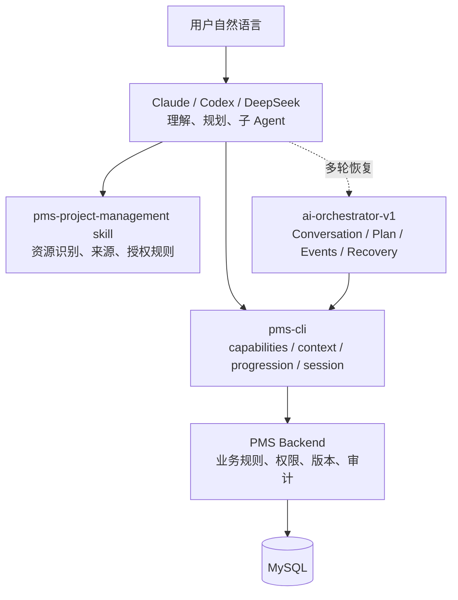

# PMS CLI 四类资源自然语言闭环与发布收口方案

日期：2026-10-21

## 目标

把已经完成的项目、专题 Orchestrator 能力收口成一个可发布、可重复验收、可被 Claude/Codex/DeepSeek 稳定调用的 PMS CLI 工作流。用户只需要用自然语言描述目标，外部 Agent 负责理解和生成草稿，`pms-cli` 负责读取 PMS 真源、校验、预览、执行和回读验证。

目标链路：

```text
用户自然语言
  → 外部 Agent 识别资源、节点和意图
  → pms capabilities / context 读取 PMS 真源
  → 外部 Agent 生成带来源的 Agent Draft
  → progression run 或 Orchestrator turn
  → PMS preview / execute / idempotency / audit
  → focused readback + verification
  → 名称优先的结果汇报
```

## 当前基线

- requirement、story、project、topic 都已经有统一 progression 能力。
- project/topic 已接入现有 `ai-orchestrator-v1`，真实隔离 E2E 已通过。
- PMS 后端仍是权限、字段、工作流、版本、事务、幂等和审计的唯一真源。
- `pms-cli` 不持有模型 URL、API Key、模型名，也不保存完整聊天记录；Claude/Codex/DeepSeek 仍是外部理解层。
- 当前两仓库仍有未提交改动，必须先形成稳定基线，再扩展自然语言调用体验。

## 架构边界



职责固定为：

- 外部 Agent：自然语言理解、资源名称解析、草稿生成、缺失信息补问、子 Agent 调度；
- skill：规定读取顺序、来源边界、写入授权、名称优先和错误处理；
- `pms-cli`：无状态 PMS 协议客户端；不猜测节点、字段、版本，不复制业务规则；
- Orchestrator：保存需要恢复的会话、计划、事件和验证结果；
- PMS：最终执行权限、字段白名单、流程校验、版本守卫、幂等和审计。

本阶段不在 CLI 内接入任何模型 endpoint，也不实现内置聊天 UI。外部 Claude/Codex/DeepSeek 继续调用 CLI。

## 四类资源统一行为

| 资源 | 只读 | 节点字段更新 | 节点完成 | 默认入口 |
| --- | --- | --- | --- | --- |
| 需求 | `context` / `READ_CONTEXT` | `UPDATE_NODE_FIELDS` | `COMPLETE_NODE` | `scenario progression run` |
| 故事 | `context` / `READ_CONTEXT` | `UPDATE_NODE_FIELDS` | `COMPLETE_NODE` | `scenario progression run` |
| 项目 | `context` / `READ_CONTEXT` | `UPDATE_NODE_FIELDS` | `COMPLETE_NODE`（由 saveContract 声明） | `scenario progression run` 或 `resource-orchestrator` |
| 专题 | `context` / `READ_CONTEXT` | `UPDATE_NODE_FIELDS` | `COMPLETE_NODE`（由 saveContract 声明） | `scenario progression run` 或 `resource-orchestrator` |

项目的 `project-basic-info` 仍属于资源级更新，不伪装成节点会话。项目/专题组件选择继续遵守：恰好一个可写 `saveContract` 可省略 `componentKey`；多个必须显式选择；零个只读可用但禁止写入。

## 自然语言调用协议

外部 Agent 每次请求都遵循：

1. 精确解析名称：`pms resolve <type> --name "<exact-name>"`；不唯一时停下来澄清。
2. 读取能力和 focused context：获取当前节点、`saveContract`、版本、来源和 `allowedActions`。
3. 生成 `agent-progression/v2` 或 `resource-node/v1` 草稿；每个写入字段必须有 `fieldSources`。
4. 低/中风险且用户明确要求写入时使用 `--execute-mode auto`；领域确认、删除、回滚和批量操作使用 preview/confirm。
5. 执行后只根据 PMS 回读和 verification 汇报；自然语言默认显示名称、节点名称和字段，不展示内部 ID。

一次自然语言请求只生成一个幂等键；同一请求发生版本冲突或回读未知时复用原幂等键。`WRITE_RESULT_UNKNOWN` 不得盲目重试。

## 分阶段交付

### 阶段 0：发布收口

Review 当前未提交改动，完成 backend 与 connector 的独立提交；执行后端定向测试、Connector 全套测试、typecheck、CLI build、`git diff --check` 和静态凭据检查。

### 阶段 1：四资源验收矩阵

统一验证四类资源的读取、计划、preview、execute、回读、`NEEDS_INPUT`、`CONFLICT`、幂等重放、能力不可用和会话恢复。项目/专题必须使用隔离数据库和运行时创建的 fixture，不能依赖固定业务 ID。

### 阶段 2：Claude/Codex 自然语言接入

补充 skill 和 runbook，使外部 Agent 能通过资源名称和自然语言目标生成规范草稿并调用 `progression run`。此阶段不把模型放进 CLI，也不在 PMS 中保存模型凭据或完整对话。

### 阶段 3：轻量会话恢复

复用现有 Orchestrator 会话，增加 CLI 的恢复投影：查看最新计划和待处理动作、继续补齐 `NEEDS_INPUT`、使用原 preview/幂等键重试未知结果。暂不做完整聊天工作台、多资源事务或自动审批。

## 验收标准

- 两仓库变更均有独立提交，工作树干净；
- 后端定向测试、Connector 全套测试、typecheck、build 通过；
- 四类资源真实隔离 E2E 全部通过；
- 每类资源均验证成功写入、缺失字段、版本冲突、幂等重放、回读失败保护；
- skill 明确模型在外部、CLI 不配置模型，且自然语言结果名称优先；
- 会话恢复不会新建平行会话表，不会绕过 PMS preview/execute；
- 发布清单和 E2E runbook 与代码、契约、命令保持一致。

## 非目标

- 不在 `pms-cli` 中实现模型调用或模型选择；
- 不新增 Orchestrator 会话模型或直接访问数据库；
- 不实现多资源事务、自动审批和完整 Web 聊天工作台；
- 不改变 requirement/story 既有契约版本和状态机；
- 不把内部 ID 作为用户可见自然语言结果的主要内容。

## 风险与控制

| 风险 | 控制 |
| --- | --- |
| 外部 Agent 猜测字段或节点 | 强制先读 `capabilities/context`，服务端再次校验 saveContract 和版本 |
| 自动写入越权 | `auto` 只适用于当前对话明确授权的低/中风险操作，高风险保留 confirm |
| 回读误判 | focused context、结构化 patch 比较、protected fields 检查和 `WRITE_RESULT_UNKNOWN` |
| 多轮状态漂移 | 复用不可变 Plan、原 preview、原幂等键和版本冲突机制 |
| 文档与实现不一致 | release gate 包含契约测试、runbook、skill 静态检查和 E2E 报告 |
